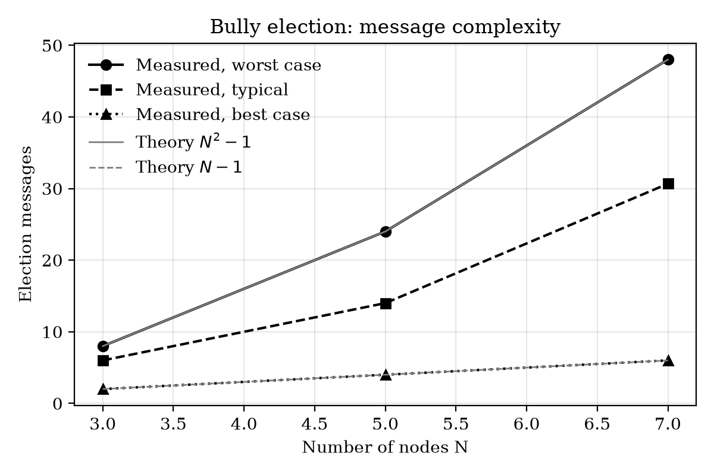
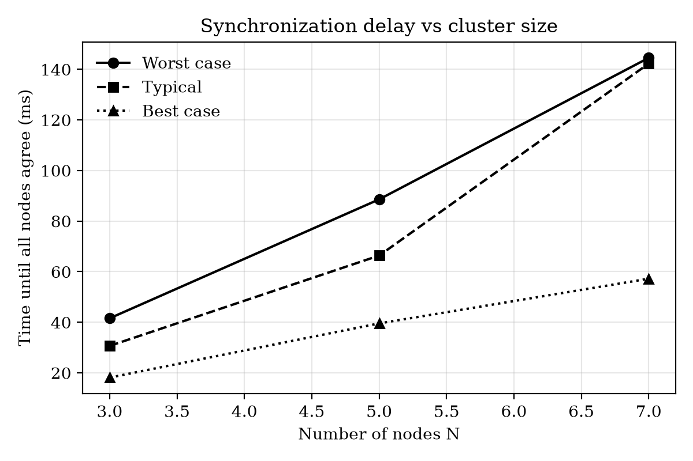
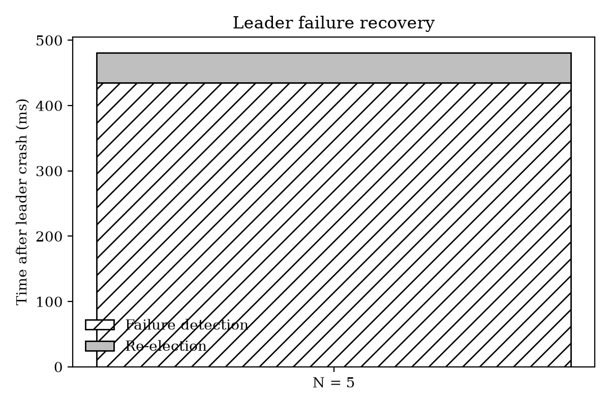
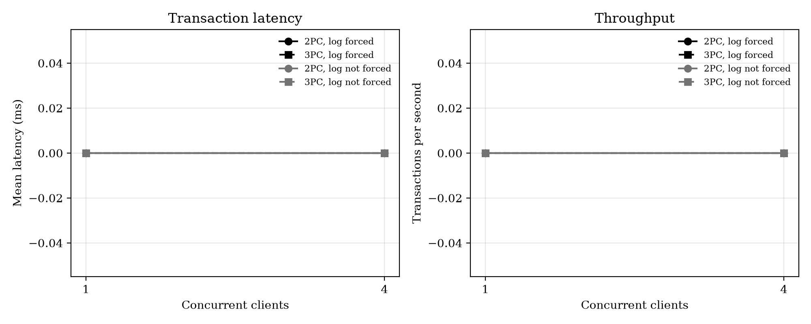
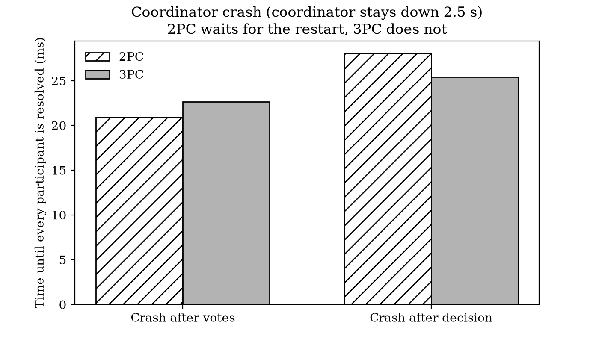
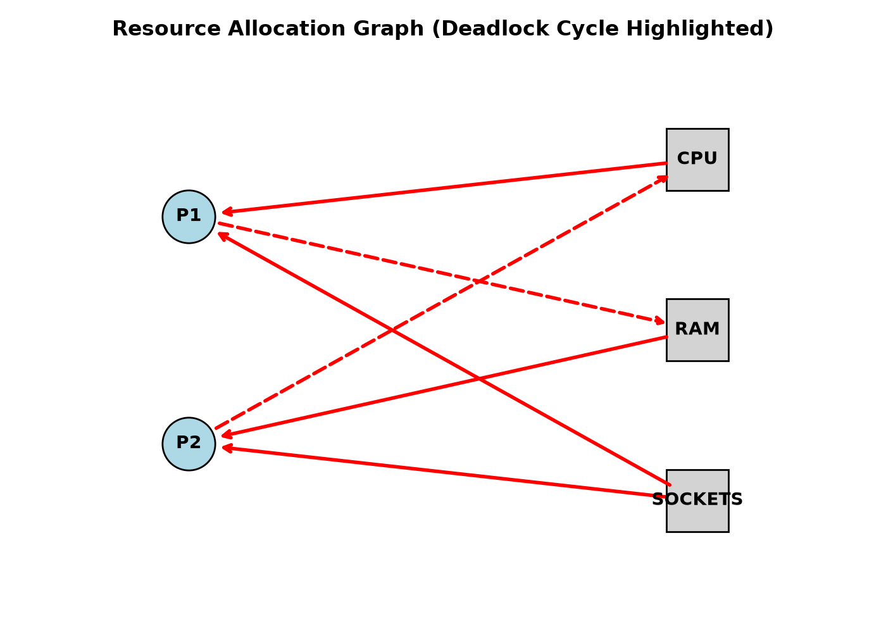
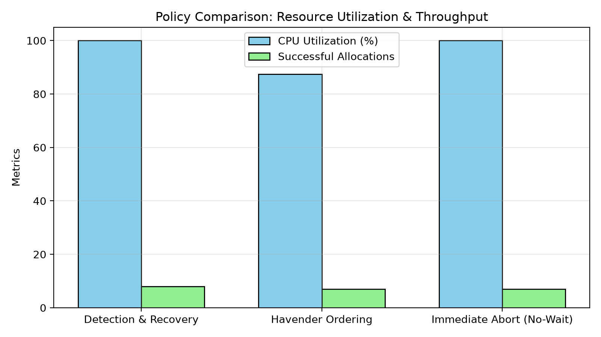
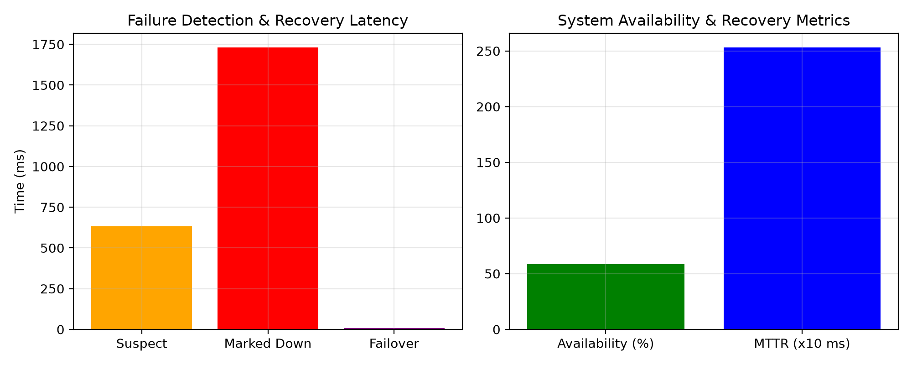

# Theme 4 – Distributed Network-Slicing Platform 🖥️🖥️
Designing a distributed system for creating, managing, monitoring, and recovering network
slices.

A distributed computing prototype designed to demonstrate the creation, management, monitoring, processing, and coordination of network slices across multiple computational nodes. The platform is being developed as an evolving telecommunications-oriented distributed system using a suitable system architecture.

# What Is Network Slicing?
Logically partitions one physical network into multiple virtual, isolated "slices"
Each slice gets its own customized bandwidth, latency, and security profile for a specific use case
Slices share the same underlying hardware but run fully independently of each other
Built on virtualization principles (SDN/NFV) that decouple network functions from physical infrastructure

# What Our Distributed System Does👩‍💻
Create - instantiate a new slice with defined resource and QoS parameters across nodes
Manage - allocate and reconfigure resources, enforcing isolation between active slices
Monitor - continuously track each slice's health, performance, and resource usage
Recover - detect failures and restore or reallocate resources to keep a slice available


# Foundational Concept
# 🖥️ Distributed OS 
presents multiple machines as one unified system with global process and resource control.
# 🖥️ Resource Allocation
Assigning computational resources - CPU, memory, bandwidth - to competing processes or slices in a controlled, trackable way.
# 🖥️ Network OS
Allows independent machines share resources while each keeps its own local OS.
# 🖥️ Computational Foundation
The base layer of nodes, connectivity, and process/resource mechanisms that all higher-level slicing logic will be built on top of.


# 🖥️ Experimental Platform and Reproducibility

All eight milestones were developed and evaluated on one fixed two-machine platform. Stating it explicitly allows any reader to repeat the experiments.

| Item | Specification |
|---|---|
| Machine 1 | **Host PC** (physical computer, development and client machine) |
| Machine 2 | **Ubuntu VM** (one virtual machine running Ubuntu Linux; runs the services and test scripts) |
| Topology | Two machines. The Edge, Core and Cloud *tiers* are separate processes (separate ports) that can run on either machine. |
| Language | Python 3 |
| Frameworks / libraries | Flask (HTTP services), `requests` (RPC client), `prometheus_client` (metrics), `matplotlib` (charts) |
| Monitoring | Prometheus metrics endpoints (`/metrics`); Grafana dashboards where used |
| Test drivers | Bash scripts (`curl`-based) and Python experiment scripts |
| Cluster description | `nodes.json` (node roles, addresses, maximum slices) |

**Installing the dependencies (Ubuntu VM):**
```bash
sudo apt update && sudo apt install -y python3 python3-pip curl
pip install flask requests prometheus_client matplotlib --break-system-packages
```

**Default ports used in this repository**

| Port | Service | Milestone |
|---|---|---|
| 5000 | Core master / gateway (`app.py`, `master_controller.py`, `core_master.py`) | 1–3, 6 |
| 5001 | Edge worker agent (`worker_agent.py`) | 2–8 |
| 5002 | Cloud telemetry service (`cloud_telemetry.py`) | 3 |
| 5005 | Temporary worker started by the Milestone 6 experiment script | 6 |
| 6200–6203 | Transaction coordinator and Edge/Core/Cloud participants | 5 |

**Method followed in every milestone.** Each milestone is reported as: *hypothesis → design → implementation → measurement → analysis → conclusion*, and the problems met along the way are recorded under "Failure-driven engineering notes" because the course values what failed and why, not only what worked.

**Screenshots.** Evidence is provided as screenshots stored in `docs/screenshots/`. Each figure below names the file it expects (for example `docs/screenshots/m2_client_sim.png`). Place your own screenshot under that name and the image will appear automatically.

---

# 🖥️Milestone 1: Distributed Operating System Foundation
## 1. Executive Summary & Design Justification
The primary objective of Milestone 1 is to establish a distributed system prototype simulating a 5G/6G Network Slicing Control Plane. Rather than running as a single centralized program on a local machine, the system is designed to operate as a distributed operating system layer across physical and virtual machine boundaries.

**Why a distributed design?** A network slice must be created, monitored and repaired while the underlying hardware is shared. A single machine would be a single point of failure and could not demonstrate the core distributed-systems problems (communication delay, partial failure, coordination). Using two machines, the Host PC and the Ubuntu VM, introduces a genuine network boundary between components, so every message between them is a real network call.

**Distributed OS versus Network OS.** In a *network OS* each machine keeps its own local operating system and only shares files or services. In a *distributed OS* the machines are presented as one system with global process and resource control. This project builds the second idea as a software layer: one controller decides on which machine each process runs, and the user sees one platform.

## 2. System Architecture

```
 Host PC                                   Ubuntu VM
 ┌──────────────────────┐   HTTP / JSON    ┌───────────────────────────────┐
 │ Client simulator     │ ───────────────► │ Core master / gateway (:5000) │
 │ Browser, curl, tests │                  │   │ schedules processes       │
 └──────────────────────┘                  │   ▼                           │
                                           │ Edge worker agent (:5001)     │
                                           │   │ telemetry                 │
                                           │   ▼                           │
                                           │ Cloud telemetry (:5002)       │
                                           └───────────────────────────────┘
```

| Component | Role | File |
|---|---|---|
| Node registry | Lists nodes, their role, IP address and maximum number of slices | `nodes.json`, `node_manager.py` |
| Control-plane API | Exposes the registry over HTTP (`/`, `/api/nodes`, `/api/nodes/<id>`) | `app.py` |
| Master controller | Accepts slice requests, chooses a worker, dispatches the process | `master_controller.py` |
| Worker | Owns local CPU/RAM, creates processes, reports health and metrics | `worker_agent.py` |

## 3. Process Model
A **process** in this system is one *network-slice instance*. Its life cycle is:

1. **Request** – a client sends `slice_type` (eMBB, URLLC or mMTC), `cpu` and `memory` to `/api/slice/request`.
2. **Scheduling** – the master asks each worker for `/health`, reading its available CPU and memory, and selects the worker with the most free memory.
3. **Creation** – the master forwards the request to the chosen worker (`/process/create`); the worker reserves the resources.
4. **Running** – the slice holds its resources until released.
5. **Rejection** – if no worker has enough capacity, the master answers `503 REJECTED` instead of overcommitting.

The three slice types follow the 5G service classes: **eMBB** (high bandwidth), **URLLC** (very low latency, high reliability) and **mMTC** (very many low-rate devices).

## 4. Resource Model
Each node has a finite capacity of **CPU cores, memory (MB)** and, in later milestones, **sockets**. The rule enforced throughout is *no oversubscription*: the sum of resources held by running slices must never exceed node capacity. Capacity is exported as Prometheus gauges (`network_slicing_available_cpu`, `network_slicing_available_ram_mb`) so that it can be observed externally.

## 5. Implementation Evidence
Run the node registry and the control-plane API on the Ubuntu VM:
```bash
python3 node_manager.py        # prints each node: role, IP address, max slices
python3 app.py                 # control plane on port 5000
curl http://127.0.0.1:5000/api/nodes
```

*Figure 1.1 – Node registry listing the cluster roles, IP addresses and slice limits.*


*Figure 1.2 – JSON response of `/api/nodes` served from the Ubuntu VM and requested from the Host PC.*

## 6. Conclusion
Milestone 1 delivers the prototype, architecture, process model and resource model required by the brief. It provides the foundation (nodes, communication and a scheduler) on which all later milestones are built.

---

# 🖥️Milestone 2: Distributed Processing and Performance Analysis
## 1. Objective
To process slice requests in a distributed manner and to measure how well the system performs.

## 2. Design
A load generator, `client_sim.py`, runs on the Host PC and sends **20 slice requests** to the master (`http://<VM address>:5000/api/slice/request`). Each request is one of the three slice types and asks for 0.2 CPU and 128 MB of memory. To make the experiment realistic, **5 % of requests are deliberately dropped** by the client to emulate packet loss.

## 3. Metrics and How They Are Calculated

| Metric | Definition |
|---|---|
| Throughput | completed requests ÷ total test duration (requests per second) |
| Latency | T<sub>response</sub> − T<sub>request</sub> for each request, averaged |
| Jitter | variation of latency between consecutive requests (a stable network has low jitter) |
| Packet loss | lost requests ÷ sent requests × 100 |
| Success / failure count | requests accepted versus rejected |

## 4. Running the Experiment
```bash
# Ubuntu VM
python3 master_controller.py
python3 worker_agent.py
# Host PC
python3 client_sim.py
```

*Figure 2.1 – Final report of the client simulator: duration, throughput, success/failure, packet loss, mean latency and jitter.*

| Metric (from Figure 2.1) | Measured value |
|---|---|
| Duration | _record from screenshot_ |
| Throughput | _record from screenshot_ |
| Successful / failed | _record from screenshot_ |
| Packet loss | ≈ 5 % (configured) |
| Mean latency | _record from screenshot_ |
| Jitter | _record from screenshot_ |

## 5. Load-Distribution and Bottleneck Analysis
The master selects the worker with the **most free memory**, so work flows to the least-loaded worker. Two bottlenecks are expected and were examined:
1. **The single master.** Every request passes through one scheduler, which also polls the workers' `/health`. As request rates grow this adds latency and the master becomes the limiting component.
2. **Worker capacity.** When CPU or memory is exhausted, requests are rejected (`503`) rather than queued, which lowers the success rate but protects running slices.

The Prometheus endpoint `/metrics` on the master aggregates worker telemetry and can be viewed in Grafana to confirm where load accumulates.


*Figure 2.2 – Worker resource usage during the load test.*

## 6. Conclusion
The experiment shows that requests are distributed across nodes, that the system tolerates lost messages, and that performance can be quantified with throughput, latency and jitter. The central scheduler is the principal scalability limit, which motivates the tiered architecture of Milestone 3.

---

# 🖥️Milestone 3: Architecture Design (Edge, Core and Cloud)
## 1. Objective
To decompose the platform into services and justify where each service should run.

## 2. Service Decomposition

| Tier | Service | File | Responsibility |
|---|---|---|---|
| **Edge** | Worker agent (:5001) | `worker_agent.py` | Executes slices close to users; exposes health and Prometheus metrics |
| **Core** | Master / gateway (:5000) | `core_master.py`, `gateway_proxy.py` | Single entry point; scheduling, routing, proxying to the edge |
| **Cloud** | Telemetry (:5002) | `cloud_telemetry.py` | Collects edge telemetry and provides global analytics (`/cloud/analytics`) |

## 3. Deployment Architecture
Clients reach only the **Core gateway**, which forwards work to the **Edge** worker. The Edge reports its state to the **Cloud**. On our testbed the three tiers are separate processes on the Ubuntu VM, while the Host PC acts as client and observer. Because tiers communicate only through HTTP, any tier can be moved to another machine by changing its address.

## 4. Edge versus Core versus Cloud Trade-offs

| Criterion | Edge | Core | Cloud |
|---|---|---|---|
| Latency to the user | Lowest | Medium | Highest |
| Compute capacity | Smallest | Medium | Largest |
| Best suited to | URLLC, time-critical slices | Coordination, admission control | Analytics, long-term storage, monitoring |
| Failure impact | One site | Whole region | Global view only |

Placing latency-sensitive work at the Edge and global analysis in the Cloud follows the same logic used by real telecom operators.

## 5. Scalability Analysis
*Horizontal scaling* is possible at the Edge: additional workers can be registered in `nodes.json` and the scheduler will include them. The Core gateway remains a single logical entry point; it can be replicated behind a load balancer, which is future work. Cloud analytics are not on the request path, so they do not limit throughput.


*Figure 3.1 – Edge, Core and Cloud services running and answering requests.*


*Figure 3.2 – `/cloud/analytics` aggregating edge telemetry.*

## 6. Conclusion
The three-tier design separates concerns, places each service where it performs best and gives a clear path to scale. These services are the nodes used by the coordination, transaction and fault-tolerance milestones that follow.

---

# 🖥️Milestone 4: Distributed Coordination and Synchronization
## 1. Objective
To let nodes agree on a **leader** and on the **order of events** without a shared clock.

## 2. Algorithms Implemented
All logic is in `coordination_engine.py`, and each node runs as a process started by `coordination_node.py`.

* **Bully leader election.** When a node notices the leader is gone it challenges every node with a higher priority (`/election/challenge`). If none answers, it declares itself leader and informs everyone (`/election/victory`). The highest-priority live node always wins.
* **Lamport logical clocks.** Every node keeps a counter; it is increased on each event and, on receiving a message, set to `max(local, received) + 1`. This guarantees that if event *a* happened before event *b*, then C(a) < C(b) (the *happens-before* relation).
* **Heartbeat failure detection.** Nodes send periodic heartbeats; silence beyond a timeout marks the node as failed and triggers a new election.

## 3. Complexity Analysis

| Scenario | Messages for N nodes |
|---|---|
| Best case (highest-priority node starts) | N − 1 |
| Worst case (lowest-priority node starts) | N² − 1 |

## 4. Experimental Results (Ubuntu VM)

| N | Best (measured) | Worst (measured) | Worst bound N²−1 | Typical mean | Worst-case delay |
|---|---|---|---|---|---|
| 3 | 2 | 8 | 8 | 6.0 | 41.6 ms |
| 5 | 4 | 24 | 24 | 14.0 | 88.6 ms |
| 7 | 6 | 48 | 48 | 30.7 | 144.5 ms |

The measured best and worst cases equal the theoretical bounds exactly, confirming the analysis.

**Leader-crash recovery (N = 5):** failure detected after 435 ms, election completed in 47 ms, total recovery 481 ms, using 12 election messages on average.

**Lamport ordering:** 100 of 100 messages were delivered and **0 ordering violations** were found.

```bash
./milestone4_test.sh          # runs all experiments and automatic checks
```

*Figure 4.1 – Messages versus number of nodes, against the N−1 and N²−1 bounds.*


*Figure 4.2 – Election delay grows with cluster size.*


*Figure 4.3 – Time to detect a crashed leader, elect a new one and recover.*


*Figure 4.4 – Terminal output of `milestone4_test.sh` showing all checks passing.*

## 5. Failure-Driven Engineering Note
At N = 7 the first runs produced 54 messages, **above** the theoretical worst case of 48. Investigation showed a race: two nodes could start an election at once and both counted messages. An atomic `_claim_election` guard was added so only one election runs per round; 80 stress runs then stayed within bounds.


## 6. Conclusion
The implemented algorithms behave exactly as the theory predicts, and the system recovers from a leader crash in under half a second.

---

# 🖥️Milestone 5: Distributed Transactions
## 1. Objective
To change resources on several nodes **all-or-nothing**, even when nodes crash. Example: a slice needs CPU and memory on Edge, Core and Cloud; either all three reserve their share or none does.

## 2. ACID Properties

| Property | Meaning in this project |
|---|---|
| Atomicity | A slice is allocated on all nodes or on none |
| Consistency | No node is ever oversubscribed |
| Isolation | Concurrent slice requests do not corrupt one another |
| Durability | A committed allocation survives a crash and restart |

## 3. Protocols Implemented

**Two-Phase Commit (2PC)**
1. *Prepare (voting):* the coordinator asks each participant to reserve resources; each replies YES or NO.
2. *Decide:* if all vote YES the coordinator logs COMMIT and tells everyone; otherwise it logs ABORT.

**Three-Phase Commit (3PC)** adds a *pre-commit* phase between voting and the final decision, so that no participant is ever left unable to decide when the coordinator fails (it is *non-blocking* under crash failures).

**Write-ahead log (WAL).** Before acting, every node writes its intention to disk (`transaction_wal.py`) and forces it with `fsync`. After a restart the log is replayed, which provides durability and recovery.

**Termination protocol.** A participant that voted YES and cannot reach the coordinator asks its peers and the coordinator's decision endpoint (`/tx/decision/<id>`) to learn the outcome instead of waiting forever.

| File | Purpose |
|---|---|
| `two_phase_coordinator.py` | Coordinator logic for 2PC and 3PC, with crash-injection points |
| `transaction_participant.py` | Participant endpoints `/tx/prepare`, `/tx/commit`, `/tx/abort` and recovery |
| `tx_coordinator_service.py` | HTTP service around the coordinator (`/tx/begin`) |
| `transaction_wal.py`, `tx_common.py` | Write-ahead log and shared helpers |

## 4. Message Cost
For *n* participants: 2PC uses **4n** messages (prepare, vote, decision, acknowledgement); 3PC uses **6n** (two extra rounds). With the three participants Edge, Core and Cloud this is **12 versus 18 messages per transaction**, so 3PC is slower but avoids blocking.

## 5. Experiments
```bash
./milestone5_test.sh           # full run (a few minutes)
./milestone5_test.sh --quick   # short smoke run
```
The script starts a coordinator on port 6200 and participants on 6201–6203, terminates processes with `SIGKILL`, and writes `results/milestone5_summary.md` and `results/milestone5_results.json`.

| Test | Question answered |
|---|---|
| T1 ACID | Is a failed allocation fully undone? Is there oversubscription under 20 concurrent requests? Is state identical after `kill -9` and restart? |
| T2 Performance | Latency (mean, p50, p95) and throughput of 2PC and 3PC with and without `fsync`, 1 and 4 clients |
| T3 Failures | F1 participant votes NO; F2 participant down before voting; F3 participant crashes after voting; F4 coordinator crashes after collecting votes; F5 coordinator crashes after deciding |
| T4 Availability | Commit rate before, during and after one node is down for one third of the workload |

**Expected behaviour (what the theory predicts and the checks verify):**
* F1, F2: both protocols ABORT cleanly; nothing is left reserved.
* F4 (coordinator crash after votes): 2PC participants are **blocked** until the coordinator recovers or the termination protocol resolves the transaction; 3PC participants can resolve it themselves.
* After every failure the global state is consistent (no partial allocation).


*Figure 5.1 – Terminal output of `milestone5_test.sh` (all automatic checks).*


*Figure 5.2 – 2PC versus 3PC latency and throughput.*


*Figure 5.3 – Time to reach a consistent state after each failure scenario.*

| Measure (fill in from your run) | 2PC | 3PC |
|---|---|---|
| Messages per transaction | 12 | 18 |
| Mean latency, 1 client (fsync on) | _from Figure 5.2_ | _from Figure 5.2_ |
| Blocks on coordinator crash (F4) | _from Figure 5.1_ | _from Figure 5.1_ |

## 6. Consistency Analysis and Limitations
Consistency is preserved because no participant commits until all have voted YES and logged their promise. 2PC is cheaper but can block; 3PC is non-blocking only for crash failures and assumes a network that does not partition. Both are therefore compromises, and the choice depends on whether lower latency or higher availability matters more. The worker's earlier "transactions" counter only counted local allocations; it is now named `network_slicing_allocations_total`, and the real transaction metrics are in the coordinator and participants.

---

# 🖥️Milestone 6: Concurrency, Resource Allocation and Deadlock Handling
## 1. Objective
To show what goes wrong when many processes compete for resources at once, and how the system prevents, detects and recovers from **deadlock**.

## 2. Key Ideas
* **Race condition:** two processes read the same free capacity and both take it, causing oversubscription. The solution is **mutual exclusion**: one lock serialises every allocation.
* **Deadlock:** a set of processes each hold a resource and wait for one held by another, forever. It requires four conditions together: mutual exclusion, hold-and-wait, no preemption, and circular wait.
* **Starvation:** a process waits indefinitely because others are always served first.
* **Resource-Allocation Graph (RAG):** processes and resources are nodes; a *request edge* P→R means P is waiting for R, and an *assignment edge* R→P means R is held by P. A cycle among waiting processes (found through the derived *wait-for graph*) indicates deadlock.

## 3. Implementation
`rag_deadlock_engine.py` implements `ResourceAllocationGraph` with resources **CPU, RAM and SOCKETS**. The Edge worker routes every allocation through it. Endpoints (served by `worker_agent.py`, proxied by `core_master.py` under `/api/...`):

| Endpoint | Function |
|---|---|
| `POST /resource/request` | Request resources; `wait=true` lets a process wait while keeping what it already holds |
| `POST /resource/release` | Release everything a process holds |
| `GET /resource/graph` | Export the allocation and request edges |
| `GET /deadlock/detect` | Search the wait-for graph for a cycle |
| `POST /deadlock/recover` | Preempt a **victim** (the lowest-cost process in the cycle) to break the cycle |
| `POST /deadlock/auto` | Background detector that detects and recovers automatically |

**Policies compared**
1. *Detection and recovery:* deadlock is allowed, found by cycle search, and broken by preempting a victim.
2. *Prevention by resource ordering (Havender):* resources must be requested in the fixed order CPU → RAM → SOCKETS, which makes a circular wait impossible; a violating request is refused with `ORDER_VIOLATION`.
3. *Immediate abort (no-wait):* a request that cannot be satisfied fails at once.

## 4. Experiments
```bash
python3 milestone6_experiments.py
```
| Demo | What is shown | Result |
|---|---|---|
| 1 Race condition | 20 processes request 1 CPU each at once on a 4-CPU node | Exactly **4 allocated**, 16 blocked, 0 CPU remaining: no oversubscription |
| 2 Starvation | Large waiting request versus small later request | *Unfair* policy lets the small request overtake; *FIFO* queues it behind the waiting one |
| 3 Live deadlock | P1 holds CPU+socket and wants RAM; P2 holds RAM+socket and wants CPU | Cycle P1↔P2 detected; one victim preempted; system proceeds |
| 4 Policy comparison | 60 random requests (fixed seed 42) under the three policies | Throughput and utilisation shown below |


*Figure 6.1 – Terminal output: 20 requests, 4 allocated, no oversubscription.*


*Figure 6.2 – Resource-allocation graph. Solid arrows are assignment edges, dashed arrows are request edges, red marks the deadlock cycle between P1 and P2.*


*Figure 6.3 – CPU utilisation and successful allocations for the three policies.*

## 5. Resource-Utilisation Analysis
From Figure 6.3, detection-and-recovery and immediate-abort reach about 100 % final CPU utilisation, whereas ordering-based prevention ends near 87 %. Detection-and-recovery completed the most allocations (about 8, against about 7 for the others). The interpretation is:
* **Prevention** never deadlocks but refuses some valid requests, so it can leave resources idle.
* **Detection and recovery** keeps resources busy but pays a cost: a victim loses its work when preempted.
* **Immediate abort** is simple but wastes requests that might have succeeded after a short wait.

The sample is small (60 requests, single seed), so these differences indicate a trend and not a statistical conclusion.


## 6. Conclusion
Mutual exclusion removes races, FIFO granting removes starvation, and the deadlock engine can both prevent and cure circular waits. A shortage of resources is correctly **not** reported as a deadlock; only a cycle is.

---

# 🖥️Milestone 7: Fault Tolerance and Recovery
## 1. Objective
To inject realistic failures, to detect them, and to measure recovery and availability.

## 2. Fault Model
| Fault | Description | How injected |
|---|---|---|
| Crash | The node stops responding | `/chaos/inject` `crash` |
| Omission | Messages are lost or not answered | `/chaos/inject` `omission` |
| Latency / timing | Responses are delayed | `/chaos/inject` `latency` |
| Byzantine | A node sends wrong or conflicting data | `byzantine_analyzer.py` |

Faults are removed with `reset`, which also records the measured MTTR and availability.

## 3. Mechanisms Implemented

| Mechanism | File | Idea |
|---|---|---|
| Failure detector | `heartbeat_detector.py` | A node moves from **UP** to **SUSPECT** to **DOWN** as heartbeats stop arriving |
| Replication and failover | `replicated_state_machine.py` | Primary-backup: the backup holds the same state and takes over when the primary fails |
| Byzantine analysis | `byzantine_analyzer.py` | Tolerating *f* faulty nodes needs at least **3f + 1** nodes |
| Experiment runner | `milestone7_experiments.py`, `milestone7_test.sh` | E1–E4 on a live cluster |
| Chaos test | `fault_injection_test.sh` | Injects faults while sending requests |

**Definitions.** *Availability* = T<sub>up</sub> / T<sub>total</sub>. *MTTR* (mean time to recovery) is the time from failure to restored service.

## 4. Results (Ubuntu VM)


| Measure | Value |
|---|---|
| Time until node is **suspected** | 633.9 ms |
| Time until node is **marked down** | 1731.8 ms |
| Failover to backup | 7.55 ms |
| State replicated to backup | Yes |
| Chaos test | 99 requests, 41 failed during the outage |
| MTTR | 2532.9 ms |
| Measured availability | 58.6 % |
| Byzantine tolerance, N = 4, f = 1 | **Safe** (4 ≥ 3·1+1) |
| Byzantine tolerance, N = 3, f = 1 | **Unsafe** (3 < 4) |
| Byzantine consensus demo | COMMIT; malicious node `N4_malicious` isolated |
| Transactions during faults | 2 committed, 1 aborted |

```bash
./milestone7_test.sh
./fault_injection_test.sh
```

*Figure 7.1 – Fault injection: failed requests during the outage and recovery.*


*Figure 7.2 – Left: detection and failover times. Right: availability (%) and MTTR (plotted ÷10, in units of 10 ms).*

## 5. Recovery-Time and Availability Analysis
Detection dominates recovery: failover takes only 7.55 ms, but the failure first needs about 0.6 s to be suspected and about 1.7 s to be confirmed. The detector deliberately waits to avoid *false positives* caused by a slow network. A shorter timeout recovers faster but wrongly declares healthy nodes dead more often; this is the central trade-off of failure detection. The 58.6 % availability is low because the experiment keeps a node failed for a large fraction of a short test and should not be read as production availability.

## 6. Failure Comparison
Crash faults are the easiest to handle (silence is detectable). Omission and latency faults are harder because a slow node is indistinguishable from a dead one, which is why a *suspect* state exists. Byzantine faults are hardest and require more nodes (3f + 1) and voting.

---

# 🖥️Milestone 8: Evaluating Distributed System Models
## 1. Objective
To compare five classical distributed-system architectures and to justify the one chosen for this platform.

## 2. The Five Models

| Model | Principle | Fit for network slicing |
|---|---|---|
| Host-based | One central machine does all work and coordination | Simple but a bottleneck and single point of failure |
| Processor pool | Work is given to any free processor in a pool | Good utilisation; coordination needed |
| Workstation | Each machine works alone | Fast and independent, but no global control or consistency |
| Server-based | Dedicated service nodes (microservices) | Clear responsibilities; matches our services |
| Integrated (hybrid) | Edge execution plus Core coordination (e.g. atomic commit) | Combines low latency with consistency |

## 3. Method
Two scripts run on the Ubuntu VM against the worker (`http://127.0.0.1:5001/resource/request`):

* `model_evaluation.sh` sends 10 slice requests (0.2 CPU, 128 MB) per model and reports duration, mean latency and throughput.
* `extended_eval.sh` sends a 15-request burst and adds CPU and RAM consumed (from the Prometheus gauges), reliability (% successful) and payload size (≈142 bytes per JSON request).

**Important limitation.** The models are *emulated*: each model is represented by the amount of coordination delay it typically adds per request (Host-based 100 ms, Processor-pool 40 ms, Workstation 0 ms, Server-based 10 ms, Integrated 20 ms). The same worker handles every request, so the experiment shows the *effect of coordination overhead on performance* and does not claim that five separate systems were built.

```bash
./model_evaluation.sh
./extended_eval.sh
```

*Figure 8.1 – Duration, mean latency and throughput for the five models.*


*Figure 8.2 – Throughput, latency, CPU/RAM consumption and reliability for the 15-request burst.*

| Model | Mean latency | Throughput | Reliability |
|---|---|---|---|
| Host-based | _from Fig. 8.1_ | _from Fig. 8.1_ | _from Fig. 8.2_ |
| Processor pool | _from Fig. 8.1_ | _from Fig. 8.1_ | _from Fig. 8.2_ |
| Workstation | _from Fig. 8.1_ | _from Fig. 8.1_ | _from Fig. 8.2_ |
| Server-based | _from Fig. 8.1_ | _from Fig. 8.1_ | _from Fig. 8.2_ |
| Integrated | _from Fig. 8.1_ | _from Fig. 8.1_ | _from Fig. 8.2_ |

As expected, the workstation model is fastest (no coordination) and the host-based model slowest (all requests serialised through one controller).

## 4. Architectural Justification
The **Integrated (Edge–Core–Cloud) model** is chosen. Its latency is close to the server-based model, far below host-based, while the Core adds what the workstation model lacks: **global coordination** (leader election, Milestone 4), **atomic multi-node allocation** (Milestone 5), **deadlock control** (Milestone 6) and **failure recovery** (Milestone 7). Pure workstation execution would be fastest but cannot guarantee consistent slices; the host-based design is simplest but fails the availability requirement. The small extra latency of the integrated model is the price paid for correctness and resilience.

## 5. Conclusion
Milestones 1–8 together form a working distributed network-slicing platform: foundation and process model (1), measured performance (2), tiered architecture (3), coordination (4), transactions (5), concurrency control (6), fault tolerance (7) and a justified choice of system model (8).
